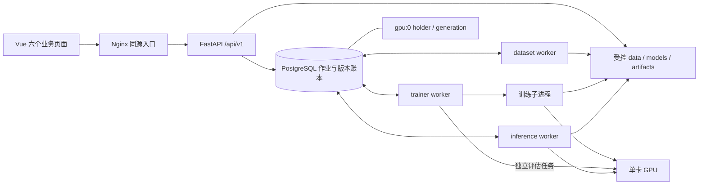
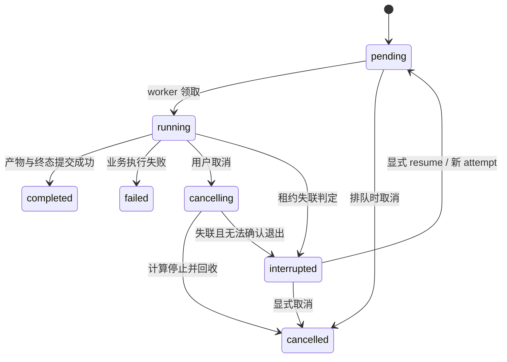

# 架构说明

平台面向公开医学图像检测实验：浏览器 → Nginx → FastAPI v1 → PostgreSQL 作业账本 → 独立 worker。DATA_ROOT、MODEL_ROOT、ARTIFACT_ROOT 是分别受控的文件根目录。

图中的 GPU 调用均以同一数据库的 `gpu:0` 租约为前置；它不是跨项目、跨数据库的 GPU 调度器。训练使用受控子进程，独立评估由 trainer 内调用适配器，推理由 inference worker 执行。API 不直接承载这些长时间计算。

| 模块 | 职责 |
|---|---|
| app/main.py | 无导入副作用的应用工厂、路由白名单、生命周期 |
| app/api/v1 | HTTP schema、鉴权与业务编排 |
| app/domains | 数据版本、草稿 CAS、作业、训练、模型、评估、推理、反馈 |
| app/ml | 实际模型适配器、训练子进程、纯几何/切片函数 |
| app/workers | dataset、trainer、inference 独立进程和健康心跳 |
| app/db | 唯一 metadata；迁移由 Compose migrate 一次性服务完成 |
| frontend/src/api/client.js | 唯一业务 HTTP 入口；401、token、统一 envelope |

## 作业与单 GPU

作业状态为 pending/running/cancelling/interrupted/completed/failed/cancelled。PG 条件更新领取、幂等键唯一约束、attempt 与 lease fencing 限制旧 worker 回写。独立心跳维持 worker/job/GPU 租约，阻塞计算不阻断续租。

训练、评估、推理共用 `gpu:0`，等待时保持心跳且可取消。GPU 过期只隔离，不自动认为旧计算已退出；精确确认所属容器停止后才能使用恢复脚本释放对应 holder/generation。训练取消会终止并回收子进程，失败不得登记成功模型。

GPU 隔离状态与 job 状态分别判断；把任务标成 interrupted 并不证明旧进程已退出。恢复时先核对 owner，再处理精确租约与任务。

## 数据与权限

导入生成 draft；冻结固化像素/标注/类别/组级 train-val-test，写 manifest 与 hash。冻结版本不可原地修改。反馈只作用于训练侧并创建子版本，继承固定 val/test 快照。BBox 坐标必须有限且在图像边界内。

客户端使用 asset/model/artifact ID；文件由后端验证受控根路径、权限及摘要后提供。ZIP 先校验完整目录、重复项、大小/压缩比/磁盘空间，再独占创建文件。模型仅允许管理员登记可信基础权重或平台训练登记。

## 新旧契约与退出旧入口

复用了 9 张既有物理表名并新增 12 张业务表，但不能将未知旧库直接 stamp head。离线拷贝转换只接受识别的旧 schema、只读一致性源事务和空目标库，保留身份、修订、血缘与文件 hash。合成演练通过不等于真实旧库已兼容。

同输入行为对照覆盖分组划分、BBox、revision 冲突序列、任务状态、模型 hash/任务版本血缘、安全解压。边界超界/NaN 采用更严格新规则。旧入口/行业代码的 163 个文件按 [清退清单](refactor/execution/unblock/legacy-cleanup-inventory.json) 移除；标注页仍用的通用撤销/重做保留。旧函数通过固定 Git 历史只在测试时读取，不进入运行镜像。

候选 GPU/浏览器验证和干净镜像、正式实验、备份恢复是分别验收的门禁；当前进度见 [STATUS](refactor/execution/unblock/STATUS.md)。
