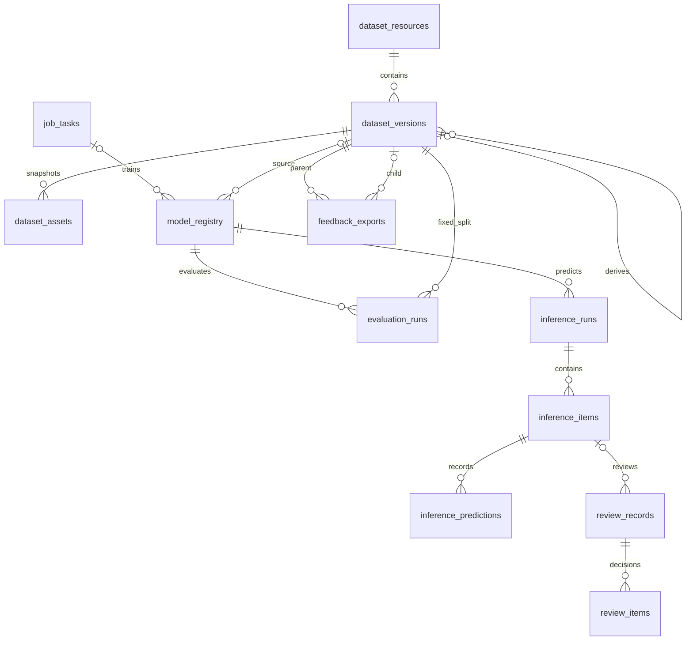
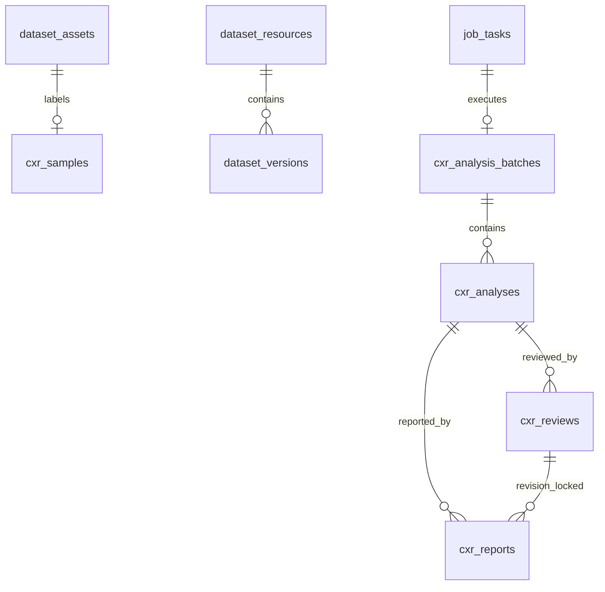

# 数据库设计

## 1. 复用与新增

沿用既有物理表：`users`、`dataset_resources`、`dataset_versions`、`dataset_assets`、
`annotation_drafts`、`annotation_draft_assets`、`job_tasks`、`job_events`、`model_registry`。
新增表用于版本治理、评估、推理、复核与血缘，见下表。

下图只表达主要逻辑引用，不代表已声明 SQL 外键；完整检查范围见第 7 节。

| 表 | 用途 | 关键约束 |
|---|---|---|
| `auth_sessions` | JWT 会话与登出撤销 | `jti` 唯一 |
| `dataset_imports` | 导入记录与报告 | `dataset_id` 索引 |
| `evaluation_runs` | val/test 评估 | `model_id`,`dataset_version_id`,`split` |
| `inference_runs` | 推理批次 | `job_id` 索引 |
| `inference_items` | 分项状态与计时 | unique(`run_id`,`asset_id`,`attempt`) |
| `inference_predictions` | 原始预测（不可被复核覆写） | `item_id` 索引 |
| `review_records` | 图像级审阅 | `state`,`revision` |
| `review_items` | 逐条结论 | `prediction_id` 可空（漏检） |
| `feedback_exports` | 回流导出 | `idempotency_key` 唯一 |
| `experiment_runs` | 实验索引与可复现元数据 | `training_job_id` |
| `artifact_records` | 受控产物 | 相对路径 + sha256 |
| `resource_leases` | GPU/worker 租约 | 主键 `resource` |

## 2. 关键字段

### dataset_versions

| 字段 | 说明 |
|---|---|
| `state` | draft / validating / frozen / failed |
| `manifest_sha256` | 规范化 manifest 的 hash（不含时间戳） |
| `split_manifest_hash` | 按三集分别排序的图像 SHA256 聚合；不含标注。实验比较另用含路径、来源组和标注的快照摘要 |
| `class_map_hash` | 类别表 hash |
| `split_config_json` | seed/ratios/group_level；回流子版本记录父版本 |
| `parent_version_id` | 子版本血缘 |

### dataset_assets

`content_hash`（SHA256）+ `source_group` + `group_level` + `split` +
`root_asset_id/original_asset_id/transform_json`。三集隔离在
`source_group / root_asset / content_hash` 三个层面同时成立。

### job_tasks

在既有列上补充 `owner_user_id`、`idempotency_key`、`request_hash`、`attempt`、
`lease_owner`、`lease_expires_at`。唯一键 `(owner_id,type,idempotency_key)`。

## 3. 索引

- 列表：`(owner_user_id, deleted_at)`、`created_at`；
- 任务：`(type,status,created_at)`；
- 资产：`(dataset_version_id, relative_path)` 唯一；
- 事件：`(task_id, sequence)` 唯一，单次查询上限 200；
- 预测：`inference_predictions(item_id)`。

## 4. 迁移策略

`backend/migrations/versions/304f405af95f_initial_medical_platform_schema.py` 在空库创建
全部 21 张业务表（实测）。

空库执行 `alembic upgrade head`，按迁移链创建业务表并补上 GPU 租约 generation；加上 `alembic_version` 共 22 张表。Compose 的一次性 migrate 服务成功后才允许 API/worker 启动。

已有由当前迁移链管理的 v1 库先做一致性备份，核对 `alembic current` 和 schema，再执行正常 `upgrade head`。未知旧库不能因为同名表存在就 `stamp`；表名相同不代表列、索引、约束和内容兼容。

旧 schema 的迁移采用 `scripts/migrate_legacy_snapshot.py` 的离线拷贝函数：源库只读 REPEATABLE READ 事务、完整 schema 指纹匹配，目标必须是新建且已迁移的空库；逐项转换标注、身份、版本血缘和受控文件，并验证行数、摘要与序列。活动任务、未知 schema、缺失文件或模糊归属均拒绝。本轮仅有三项合成 PostgreSQL 演练通过；真实旧库副本仍未提供，不能声称已兼容真实历史数据。

不得在生产对象上 `create_all`/`drop_all`；行业表不进入新应用 metadata，删除另列迁移。

## 5. 不变量

- 冻结版本内容 hash 不变；
- 一次回流导出只产生一个子版本；
- 预测原始记录不可被 review 覆写；
- completed/failed/cancelled 不直接回到运行态；interrupted 只经显式 resume 增加 attempt 后重新排队，旧 attempt 无权回写；
- 删除被模型/训练/子版本引用的版本返回 409。

## 6. GPU 租约

`resource_leases` 记录 `resource/holder/generation/job_id/expires_at`。训练、评估、推理在同一数据库内竞争 `gpu:0`。过期持有者进入隔离，不能仅凭到期时间被新 worker 抢占；旧 holder/generation 必须在确认对应进程停止后精确恢复。作业 attempt、租约 generation 与心跳分别限制旧执行者回写。另一套数据库无法参与此互斥，恢复演练启动 GPU worker 前必须停止原项目的 GPU worker。

## 7. 引用检查边界

当前模型未声明 SQL ForeignKey；跨表引用主要由域服务检查，不能把本文件的关系描述误认为数据库强制外键。`scripts/audit_database_links.py` 在只读一致性快照中对 48 项明确的非空标量引用执行反连接检查。2026-10-22 对本轮恢复库实测均为 0 悬空引用；该结果只说明受检关系，不涵盖 JSON、多态 resource_id、授权及全部业务语义。后续若引入物理 FK，应先审计数据并设计增量迁移，不在正式训练中改变 schema。

## 8. CXR 五标签表（Alembic `4a6b1222f003`）

新增 5 张表，接在 `4a6b1222f002` 之后；不 drop 旧表、不 stamp 未知库、不批量改旧记录。

| 表 | 主键/唯一 | 关键列 |
|---|---|---|
| `cxr_samples` | `id`；`asset_id` 唯一 | `dataset_version_id`、`patient_key`/`study_key`/`component_key`、`view`、`raw_labels_json`（四态）、`pixel_hash`、`source_hash` |
| `cxr_analysis_batches` | `id`；`(owner_id, idempotency_key)`；`job_id` 唯一 | `model_id/model_sha256`、`request_hash`、`status/total/completed/failed` |
| `cxr_analyses` | `id`；`(batch_id, item_key, attempt)` | `asset_id`(nullable)、`upload_ref`、`raw_scores_json`/`calibrated_scores_json`/`thresholds_json`、`calibration_status`/`threshold_source`、`quality_json`、`explanation_*`、`backend`、`attempt` |
| `cxr_reviews` | `id`；`(analysis_id, owner_id)` | `state`、`revision`（CAS）、`items_json`、`model_snapshot_json`（原评分不可覆写）、`decided_by_*` |
| `cxr_reports` | `id`；`(analysis_id, version)` | `review_id + review_revision`、`state`、`supersedes_id`、`snapshot_json + snapshot_sha256`、`issued_by_*` |

**外键**：`cxr_samples.asset_id`、`cxr_analyses.batch_id/asset_id`、`cxr_reviews.analysis_id`、`cxr_reports.analysis_id/review_id` 均为
`FOREIGN KEY ... ON DELETE RESTRICT`。这是本项目首次声明物理 FK：软删除的模型/资产仍保留引用，审核与报告不级联物理删除历史。
旧表关系仍由域服务检查（见第 7 节），本节的 FK 不改变旧表行为。

**与 detect 的边界**：`cxr_samples.annotations_json` 对 CXR 恒为空（不生成假 BBox）；`dataset_resources.task_type` 默认仍为 `detect`，
CXR 数据集显式写 `cxr_multilabel`；`group_level` 为 CXR 专属 `patient_component`，未并入旧 `GROUP_LEVELS`。

**迁移验证**：空库 21→27 表；重复 upgrade 无变更；`downgrade 4a6b1222f002` 只删 5 张 CXR 表且 `dataset_assets` 等保留；再 upgrade 成功。
真实库副本升级 **NOT_RUN**（无可用 PG/容器）。
